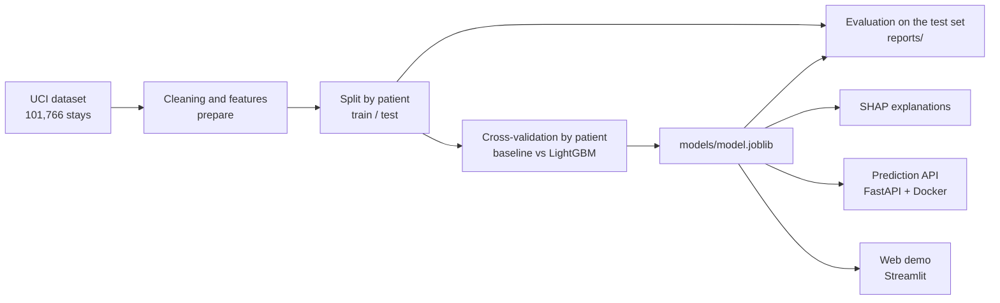

# Readmission Risk: reingreso hospitalario a 30 días en pacientes diabéticos

[English](README.md) | **Español**

[](https://github.com/agilmouzo/readmission-risk/actions/workflows/ci.yml)
[](LICENSE)
[](https://agilmou-readmission-risk.streamlit.app/)

> Proyecto educativo. **No es una herramienta clínica.**

**[Prueba la demo en vivo](https://agilmou-readmission-risk.streamlit.app/)**: rellena una estancia
hospitalaria y verás la probabilidad estimada de que el paciente vuelva en un plazo de 30 días.
(Funciona en un plan gratuito, así que la primera carga tras un periodo de inactividad puede tardar
un minuto. Está disponible en español e inglés.)


## En resumen
- **Pregunta:** dado lo que se sabe cuando un paciente diabético sale del hospital, ¿qué
  probabilidad hay de un reingreso en un plazo de 30 días?
- **Datos:** [Diabetes 130-US Hospitals (1999–2008)](https://archive.ics.uci.edu/dataset/296), del
  UCI Machine Learning Repository (un archivo público de conjuntos de datos que mantiene la
  Universidad de California en Irvine): 101.766 estancias hospitalarias de 71.518 pacientes.
- **Modelo:** árboles de decisión con gradient boosting (LightGBM), comparado con una regresión
  logística de referencia, usando validación cruzada que nunca reparte a un mismo paciente entre
  varios grupos.
- **Resultado, con honestidad:** el modelo sirve para *ordenar* pacientes por riesgo, no para
  predecirlos uno a uno. El 10 % de pacientes que clasifica como de mayor riesgo reingresa el
  **28,5 %** de las veces, frente al **11,2 %** del total (2,5 veces más). La capacidad global de
  discriminación es modesta (AUC-ROC 0,68).
- **Se entrega como:** scripts reproducibles de entrenamiento y evaluación, explicaciones SHAP, un
  análisis por subgrupos, una API de predicción documentada (FastAPI + Docker) y una demo web
  (Streamlit).
- **Calidad:** 133 tests, ruff, CI en Python 3.11 y 3.13.

## Pruébalo
**En línea:** la [demo en vivo](https://agilmou-readmission-risk.streamlit.app/).

**En tu máquina, sin entrenar nada** (el modelo entrenado se publica como una
[Release de GitHub](https://github.com/agilmouzo/readmission-risk/releases)):
```bash
git clone https://github.com/agilmouzo/readmission-risk.git && cd readmission-risk
python3 -m venv .venv && source .venv/bin/activate
pip install -e ".[demo]"
python scripts/download_model.py                 # saves models/model.joblib (under 1 MB)
streamlit run app/streamlit_app.py               # the web demo
uvicorn readmission.api:create_app --factory     # or the API, with docs at http://127.0.0.1:8000/docs
```
La API tiene su propia página interactiva de documentación. Cada campo tiene una descripción y hay
un ejemplo ya rellenado, así que puedes probarla sin conocer el dataset:


**Reproduce todo a partir de los datos originales:**
```bash
pip install -e ".[dev]"
python scripts/download_data.py                  # downloads the dataset from UCI into data/raw/
pytest                                           # 133 tests
python -m readmission.train                      # patient-level CV, saves models/model.joblib
python -m readmission.evaluate                   # opens the test set ONCE; tables and figures in reports/
python -m readmission.explain                    # SHAP explanations on a training sample
```
Si la descarga desde UCI está bloqueada, descarga el zip desde la página del dataset y extráelo en
`data/raw/`.

## Cómo funciona

La API y la demo llaman a la misma función `prepare` y a la misma selección de columnas que el
entrenamiento, de modo que el servicio no puede desviarse del modelo.

| Carpeta | Qué contiene |
|---|---|
| `src/readmission/` | el paquete: limpieza (`features`), entrenamiento, evaluación, SHAP, servicio y API |
| `notebooks/` | `01_eda` (exploración de datos) y `02_features` (qué hace la limpieza) |
| `reports/` | todos los resultados en CSV, más las figuras que se muestran abajo |
| `app/` | la demo de Streamlit |
| `scripts/` | descarga de los datos y del modelo entrenado |
| `tests/` | tests unitarios, un test de equivalencia API frente a lote y un contrato de variables congelado |
| `MODEL_CARD.md` | la [ficha del modelo](MODEL_CARD.md) (en inglés): para qué sirve, sus datos, resultados y límites |

## Resultados
### Comparación de modelos (validación cruzada sobre el conjunto de entrenamiento)
| Modelo | AUC-ROC | AUC-PR |
|---|---|---|
| Predecir siempre la media (referencia) | 0,500 | 0,114 |
| Regresión logística | 0,664 | 0,209 |
| LightGBM (elegido) | 0,675 | 0,230 |

LightGBM es mejor, pero solo en unos 0,01 de AUC-ROC respecto a una regresión logística sencilla.
En estos datos la señal es débil, y un modelo más complejo no la cambia demasiado.

### Conjunto de test
Conjunto de test apartado: 19.802 estancias de pacientes que el modelo nunca vio en el
entrenamiento. Los intervalos al 95 % salen de remuestrear pacientes, no filas.

| Métrica | Valor (IC 95 %) |
|---|---|
| AUC-ROC | 0,676 (0,660–0,690) |
| AUC-PR (aleatorio = 0,112) | 0,234 (0,211–0,257) |
| Puntuación de Brier | 0,094 (0,090–0,098) |
| Tasa de reingreso en el 10 % de pacientes de mayor riesgo | 28,5 % frente a 11,2 % del total (lift 2,5×) |
| Proporción de todos los reingresos encontrados en ese 10 % | 25 % (en el 30 % superior: 51 %) |

Puntos de operación (umbrales elegidos con predicciones fuera de muestra sobre el conjunto de
entrenamiento):

| Regla | Pacientes marcados | Precisión | Recall |
|---|---|---|---|
| 10 % de mayor riesgo (umbral 0,197) | 9,7 % | 28,6 % | 24,9 % |
| F1 óptimo (umbral 0,135) | 26,2 % | 20,1 % | 47,1 % |

En lenguaje llano: marcar el 10 % de mayor riesgo encuentra aproximadamente uno de cada cuatro
reingresos, y unos 3 de cada 10 pacientes marcados vuelven de verdad. Marcar más pacientes encuentra
más reingresos (47 %), pero la mayoría de las marcas (80 %) son falsas alarmas.

La calibración es buena (pendiente 1,06, error de calibración esperado 0,007): un riesgo predicho
del 20 % corresponde a que aproximadamente el 20 % de esos pacientes reingrese. Esto vale para el grupo en
conjunto: no significa que la cifra de un paciente concreto sea igual de precisa. El modelo separa a
los pacientes solo de forma modesta, así que una estimación individual puede quedar lejos de lo que
le ocurra a esa persona.

**Subgrupos.** (Una diferencia de AUC por sí sola no demuestra trato injusto ni su ausencia; con pocos
casos la incertidumbre es grande.) No hay diferencia relevante por género ni entre los dos grupos grandes de raza
(afroamericanos: AUC-ROC 0,667 frente a caucásicos: 0,675, con intervalos que se solapan); los
grupos de raza más pequeños tienen muy pocos casos para sacar conclusiones. La discriminación es
claramente menor en pacientes de 80 años o más (0,632) que en menores de 40 (0,777). Las tablas
completas están en `reports/`.


## En qué se fija el modelo (SHAP)
SHAP descompone cada predicción en una contribución por variable: partiendo del riesgo medio, cada
variable empuja el riesgo del paciente hacia arriba o hacia abajo. Se calcula sobre 5.000 pacientes
de entrenamiento; las contribuciones están en log-odds, así que solo importan su signo y su tamaño
relativo.

- La variable más influyente es el **número de ingresos hospitalarios previos** (el 20 % del
  impacto medio total), seguida del **destino al alta** (17 %) y del **número total de visitas
  previas** (9 %). Los ingresos hospitalarios forman parte de ese total, así que el uso previo del
  hospital en conjunto pesa alrededor del 29 %.
- El riesgo crece de forma constante con el número de ingresos previos y con el número de
  diagnósticos, y es más alto a partir de los 60 años.
- Son asociaciones aprendidas de los datos, no causas. El tipo de seguro (`payer_code`, 5 %)
  también lo usa el modelo y puede actuar como indicador indirecto del nivel socioeconómico.


## API de predicción
Un pequeño servicio FastAPI puntúa a un paciente. La entrada usa los nombres de campo del dataset
original (edad en años en lugar de un tramo); los diagnósticos, el pagador, la especialidad, los
resultados de laboratorio y los medicamentos son opcionales. `GET /codes` lista el significado de los
códigos numéricos (tipo de ingreso, destino al alta, origen del ingreso), y `/docs` incluye un ejemplo
listo para ejecutar.

```bash
curl -s localhost:8000/predict -H "Content-Type: application/json" -d '{
  "age": 72,
  "gender": "Female",
  "admission_type_id": 1,
  "discharge_disposition_id": 1,
  "admission_source_id": 7,
  "time_in_hospital": 4,
  "num_lab_procedures": 45,
  "num_procedures": 1,
  "num_medications": 14,
  "number_outpatient": 0,
  "number_emergency": 1,
  "number_inpatient": 2,
  "number_diagnoses": 8,
  "diag_1": "428",
  "diag_2": "250",
  "diag_3": "401",
  "payer_code": "MC",
  "medical_specialty": "InternalMedicine",
  "A1Cresult": ">8",
  "change": "Ch",
  "diabetesMed": "Yes",
  "insulin": "Steady",
  "metformin": "Steady"
}'
```
```json
{
  "readmission_probability": 0.15234210787332797,
  "high_risk": false,
  "threshold": 0.1971,
  "baseline_risk": 0.112,
  "relative_risk": 1.3601973917261425,
  "summary": "Estimated 15% chance of readmission within 30 days (1.4x the 11% average); below the high-risk threshold."
}
```
`high_risk` significa que la probabilidad predicha supera el umbral de alto riesgo. Ese umbral
(0.1971) se fijó con predicciones de validación sobre el conjunto de entrenamiento para que marque
aproximadamente al 10 % de los pacientes; en el conjunto de test marca el 9,7 %, y en otra población
podría marcar una proporción distinta. Las altas por fallecimiento o a cuidados paliativos (hospice) quedan fuera del
alcance del modelo y reciben un HTTP 422 claro en lugar de una probabilidad. `GET /health` indica qué archivo de modelo está cargado:
su versión (`v0.1.0` si es el publicado, `custom` si no) y su SHA-256.

**Docker.** La imagen solo contiene lo necesario para servir el modelo (sin SHAP ni gráficos).
Copia el modelo entrenado, así que consíguelo antes con `python scripts/download_model.py` (o
entrénalo). `constraints.txt` está versionado y fija las versiones de las librerías con las que se
guardó el modelo; regéneralo solo si reentrenas en un entorno nuevo.
```bash
docker build -t readmission-api .
docker run --rm -p 8000:8000 readmission-api     # docs at http://127.0.0.1:8000/docs
```

## Decisiones de diseño
- Objetivo binario: reingreso en menos de 30 días frente a todo lo demás.
- División entrenamiento/test **por paciente** (`patient_nbr`): un mismo paciente puede aparecer en
  muchas estancias, y una división aleatoria lo colaría en ambos conjuntos e inflaría las métricas.
- Se excluyen las altas por fallecimiento y a cuidados paliativos (hospice): esos pacientes no
  pueden reingresar.
- `race` se excluye de las variables del modelo y se usa solo para comparar el rendimiento entre
  grupos.
- El conjunto de test se abre una sola vez, después de tomar todas las decisiones (modelo, umbrales)
  con validación cruzada sobre el conjunto de entrenamiento.
- Métricas adecuadas para un suceso poco frecuente (11 %): AUC-PR, lift y calibración, en lugar de
  accuracy.

## Limitaciones
- **Datos antiguos y solo de EE. UU.** (1999–2008, 130 hospitales estadounidenses). La práctica
  clínica, la codificación y el perfil de pacientes han cambiado, y el modelo no tiene validez para
  otros sistemas de salud, incluido el español.
- **Poder predictivo modesto.** El AUC-ROC es 0,68. La mayoría de los reingresos no se marcan, y la
  mayoría de las marcas son falsas alarmas. Ordena mejor a grupos de pacientes de lo que predice a
  individuos.
- **Qué significa «reingreso» aquí.** El objetivo es un reingreso registrado en menos de 30 días en
  este dataset. Los datos no permiten saber si fue planificado, evitable o relacionado con la
  atención recibida.
- **Sin validar fuera de este dataset.** Dividir por paciente evita la fuga de información entre
  estancias de una misma persona, pero entrenamiento y test proceden de los mismos hospitales y años
  de EE. UU. No hay validación temporal ni prueba en hospitales externos; sería un siguiente paso
  natural si hubiera datos adecuados.
- **Predice en el momento del alta.** Usa información disponible cuando el paciente se va, así que
  no sirve para usarse antes durante la estancia.
- **Equidad.** Dejar fuera `race` no elimina los indicadores indirectos: `payer_code` y la
  especialidad médica pueden llevar información socioeconómica. El rendimiento es menor en pacientes
  de 80 años o más.
- **SHAP muestra asociaciones, no causas.** Que una variable suba el riesgo predicho no significa
  necesariamente que sea una razón del reingreso.
- **Sin un ajuste exhaustivo** y basado solo en las variables de este dataset.
- **Sin uso clínico.** La API no tiene autenticación ni límite de peticiones y es una demostración,
  no un servicio reforzado para producción.

## Datos y licencia
Datos: Clore, J., Cios, K., DeShazo, J. y Strack, B. (2014). *Diabetes 130-US Hospitals for Years
1999-2008*. UCI Machine Learning Repository. https://doi.org/10.24432/C5230J (CC BY 4.0). No está
incluido en este repositorio.

Estudio original: Strack, B. et al. (2014). *Impact of HbA1c Measurement on Hospital Readmission
Rates: Analysis of 70,000 Clinical Database Patient Records.* BioMed Research International.

Código: [Licencia MIT](LICENSE).
