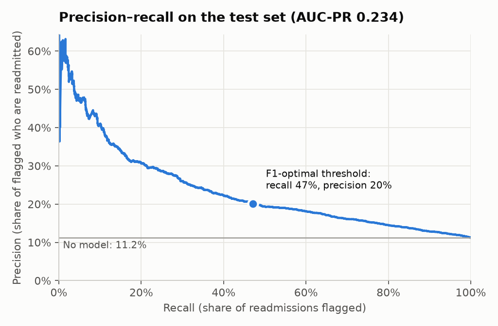
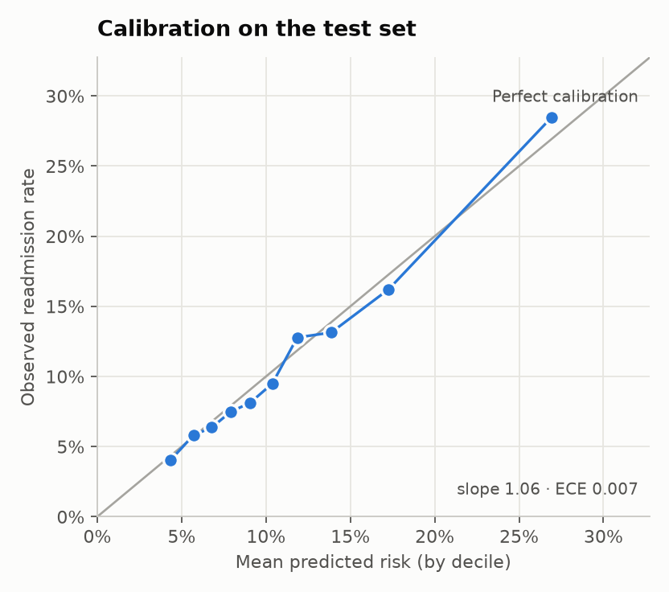
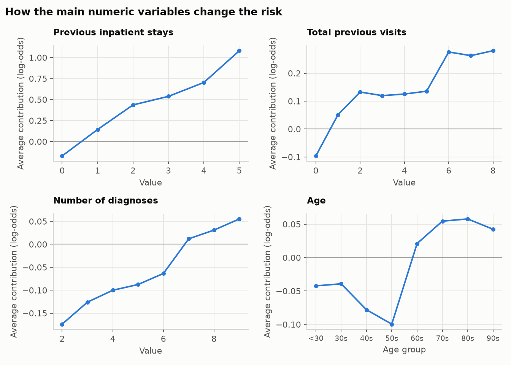
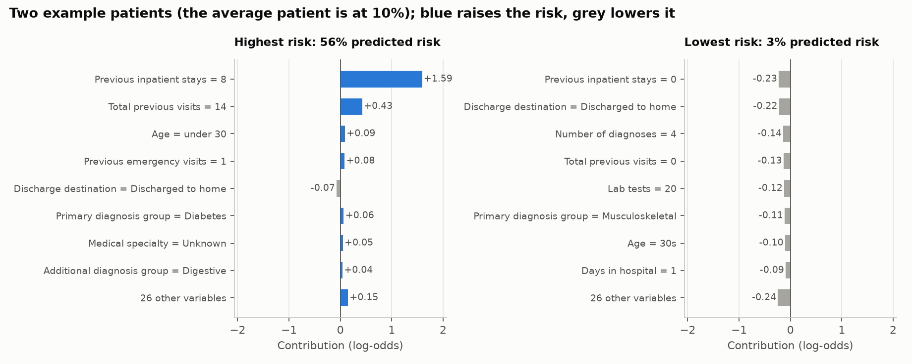

# Readmission Risk — 30-day hospital readmission for diabetic patients

> Educational project. **Not a clinical tool.**

End-to-end machine learning project: data exploration, a gradient-boosted model,
explainability (SHAP), subgroup analysis, and a containerised prediction API.

## Dataset
[Diabetes 130-US Hospitals (1999–2008)](https://archive.ics.uci.edu/dataset/296), UCI Machine
Learning Repository: ~100k hospital encounters, de-identified. The data is not committed;
it is downloaded by a script.

## Quickstart
```bash
python3 -m venv .venv && source .venv/bin/activate
pip install -e ".[dev]"
python scripts/download_data.py
pytest
python -m readmission.train      # compares models with patient-level CV, saves models/model.joblib
python -m readmission.evaluate   # opens the test set ONCE; writes tables and figures to reports/
python -m readmission.explain    # SHAP explanations on a sample of the training set
uvicorn readmission.api:create_app --factory   # prediction API at http://127.0.0.1:8000/docs
```

## Project status
- [x] Repo skeleton, data download, CI
- [x] EDA
- [x] Cleaning and features
- [x] Modelling (baseline + LightGBM)
- [x] Evaluation (AUC-PR, calibration, threshold, subgroups)
- [x] Explainability (SHAP)
- [x] API (FastAPI) + Docker
- [ ] Final README: results, limitations

## Test-set results
Hold-out test set: 19,802 encounters from patients never seen in training. 95% intervals come from
resampling patients, not rows.

| Metric | Value (95% CI) |
|---|---|
| AUC-ROC | 0.676 (0.660–0.690) |
| AUC-PR (random = 0.112) | 0.234 (0.211–0.257) |
| Brier score | 0.094 (0.090–0.098) |
| Readmission rate in the 10% highest-risk patients | 28.5% vs. 11.2% overall (lift 2.5×) |
| Share of all readmissions found in that 10% | 25% (top 30%: 51%) |

Operating points (threshold chosen on out-of-fold predictions over the training set):

| Rule | Patients flagged | Precision | Recall |
|---|---|---|---|
| Top 10% highest risk (threshold 0.197) | 9.7% | 28.6% | 24.9% |
| F1-optimal (threshold 0.135) | 26.2% | 20.1% | 47.1% |

Calibration is good (slope 1.06, expected calibration error 0.007): a predicted 20% risk
corresponds to about 20% of those patients being readmitted.

**Subgroups.** No meaningful difference by gender or between the two large race groups
(African American AUC-ROC 0.667 vs. Caucasian 0.675, overlapping intervals); smaller race groups
have too few cases to conclude anything. Discrimination is clearly lower in patients aged 80+
(0.632) than under 40 (0.777). Full tables and figures are in `reports/`.





## What the model looks at (SHAP)
SHAP splits each prediction into one contribution per variable: starting from the average risk
(10%), every variable pushes the patient's risk up or down. Computed on 5,000 training patients;
contributions are in log-odds, so only their sign and relative size matter.

- The most influential variable is the **number of previous inpatient stays** (20% of the total
  average impact), followed by the **discharge destination** (17%) and the **total number of
  prior visits** (9%). Inpatient stays are part of that total, so prior hospital use as a whole
  weighs about 29%.
- Risk grows steadily with the number of previous inpatient stays and with the number of
  diagnoses, and is higher from the age of 60.
- These are associations learned from data, not causes. The insurance type (`payer_code`, 5%) is
  also used by the model and may act as a proxy for socioeconomic status.





## Prediction API
A small FastAPI service scores one patient. It runs the same cleaning (`prepare`) and the same
column selection as training, so it cannot drift from the model. The input uses the field names of
the original dataset (age in years instead of a bracket); diagnoses, payer, specialty, lab results
and medications are optional.

```bash
python -m readmission.train                     # creates models/model.joblib
uvicorn readmission.api:create_app --factory    # interactive docs and an example at /docs
```
```bash
curl -s localhost:8000/predict -H "Content-Type: application/json" -d '{
  "age": 72, "gender": "Female", "admission_type_id": 1, "discharge_disposition_id": 1,
  "admission_source_id": 7, "time_in_hospital": 4, "num_lab_procedures": 45, "num_procedures": 1,
  "num_medications": 14, "number_outpatient": 0, "number_emergency": 1, "number_inpatient": 2,
  "number_diagnoses": 8}'
# {"readmission_probability": 0.2, "high_risk": true, "threshold": 0.1971}
```
`high_risk` means the patient is among the 10% with the highest predicted risk (the cut-off
evaluated above). Discharges to death or hospice are outside the model's scope and get a clear
HTTP 422 instead of a probability.

**Docker.** The image only contains what serving needs (no SHAP, no plotting). It copies the
trained model, so train first; `constraints.txt` pins the library versions the model was saved
with:
```bash
pip freeze | grep -iE '^(numpy|pandas|scikit-learn|scipy|lightgbm|joblib|threadpoolctl|fastapi|uvicorn|starlette|pydantic|pydantic-core|anyio|typing-extensions)==' > constraints.txt
docker build -t readmission-api .
docker run --rm -p 8000:8000 readmission-api
```

## Design decisions
- Binary target: readmitted in < 30 days vs. everything else.
- Train/test split **by patient** (`patient_nbr`) to avoid leakage between encounters.
- `race` is excluded from the features and used only for subgroup performance analysis.

## Limitations
_To be completed._