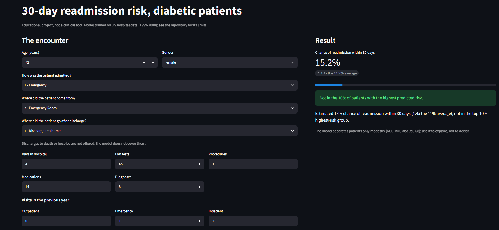
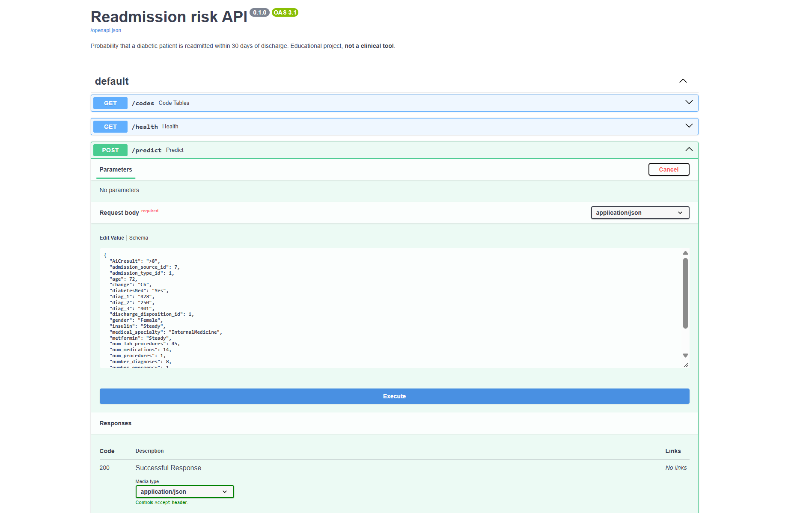
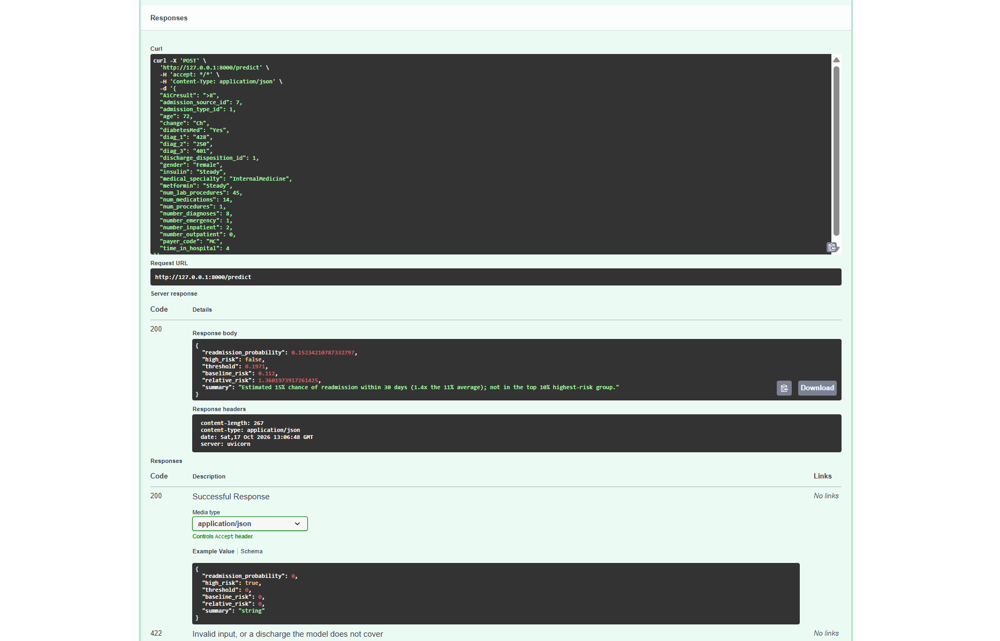
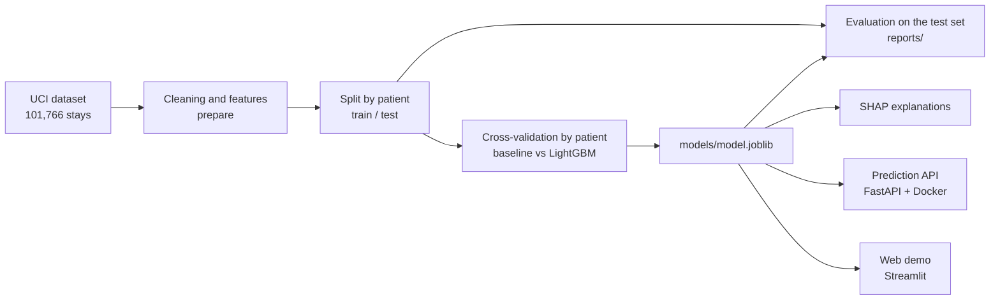

# Readmission Risk: 30-day hospital readmission for diabetic patients

**English** | [Español](README.es.md)

[](https://github.com/agilmouzo/readmission-risk/actions/workflows/ci.yml)
[](LICENSE)
[](https://agilmou-readmission-risk.streamlit.app/)

> Educational project. **Not a clinical tool.**

**[Try the live demo](https://agilmou-readmission-risk.streamlit.app/)**: fill in one hospital stay and
see the estimated chance that the patient comes back within 30 days. (It runs on a free tier, so
the first load after a period of inactivity can take a minute. It is available in English and Spanish.)



## In short
- **Question:** given what is known when a diabetic patient leaves hospital, how likely is a
  readmission within 30 days?
- **Data:** [Diabetes 130-US Hospitals (1999–2008)](https://archive.ics.uci.edu/dataset/296), from the UCI Machine Learning Repository (a public archive of datasets run by the University of California, Irvine):
  101,766 hospital stays from 71,518 patients.
- **Model:** gradient-boosted trees (LightGBM), compared with a logistic regression baseline
  using cross-validation that never splits a patient across folds.
- **Result, honestly:** the model is useful for *ranking* patients, not for predicting them
  one by one. The 10% of patients it ranks highest are readmitted **28.5%** of the time, against
  **11.2%** overall (2.5× more). Overall discrimination is modest (AUC-ROC 0.68).
- **Delivered as:** reproducible training and evaluation scripts, SHAP explanations, a subgroup
  analysis, a documented prediction API (FastAPI + Docker) and a web demo (Streamlit).
- **Quality:** 133 tests, ruff, CI on Python 3.11 and 3.13.

## Try it
**Online:** the [live demo](https://agilmou-readmission-risk.streamlit.app/).

**On your machine, without training anything** (the trained model is published as a
[GitHub Release](https://github.com/agilmouzo/readmission-risk/releases)):
```bash
git clone https://github.com/agilmouzo/readmission-risk.git && cd readmission-risk
python3 -m venv .venv && source .venv/bin/activate
pip install -e ".[demo]"
python scripts/download_model.py                 # saves models/model.joblib (under 1 MB)
streamlit run app/streamlit_app.py               # the web demo
uvicorn readmission.api:create_app --factory     # or the API, with docs at http://127.0.0.1:8000/docs
```
The API is documented in its own interactive page. Every field has a description and an example is
pre-filled, so you can try it without knowing the dataset:




**Reproduce everything from the raw data:**
```bash
pip install -e ".[dev]"
python scripts/download_data.py                  # downloads the dataset from UCI into data/raw/
pytest                                           # 133 tests
python -m readmission.train                      # patient-level CV, saves models/model.joblib
python -m readmission.evaluate                   # opens the test set ONCE; tables and figures in reports/
python -m readmission.explain                    # SHAP explanations on a training sample
```
If the UCI download is blocked, get the zip from the dataset page and extract it into `data/raw/`.

## How it works

The API and the demo call the same `prepare` function and the same column selection as training,
so serving cannot drift from the model.

| Folder | What is in it |
|---|---|
| `src/readmission/` | the package: cleaning (`features`), training, evaluation, SHAP, service and API |
| `notebooks/` | `01_eda` (data exploration) and `02_features` (what the cleaning does) |
| `reports/` | every result as CSV, plus the figures shown below |
| `app/` | the Streamlit demo |
| `scripts/` | download of the data and of the trained model |
| `MODEL_CARD.md` | the [model card](MODEL_CARD.md): what the model is for, its data, results and limits |
| `tests/` | unit tests, an API-vs-batch equivalence test and a frozen feature contract |
| `MODEL_CARD.md` | what the model is for, how well it works and where not to use it |

## Results
### Model comparison (cross-validation on the training set)
| Model | AUC-ROC | AUC-PR |
|---|---|---|
| Always predict the average (reference) | 0.500 | 0.114 |
| Logistic regression | 0.664 | 0.209 |
| LightGBM (chosen) | 0.675 | 0.230 |

LightGBM is better, but only by about 0.01 of AUC-ROC over a plain logistic regression. In this
data the signal is weak, and a more complex model does not change that much.

### Test set
Hold-out test set: 19,802 stays from patients never seen in training. 95% intervals come from
resampling patients, not rows.

| Metric | Value (95% CI) |
|---|---|
| AUC-ROC | 0.676 (0.660–0.690) |
| AUC-PR (random = 0.112) | 0.234 (0.211–0.257) |
| Brier score | 0.094 (0.090–0.098) |
| Readmission rate in the 10% highest-risk patients | 28.5% vs. 11.2% overall (lift 2.5×) |
| Share of all readmissions found in that 10% | 25% (top 30%: 51%) |

Operating points (thresholds chosen on out-of-fold predictions over the training set):

| Rule | Patients flagged | Precision | Recall |
|---|---|---|---|
| Top 10% highest risk (threshold 0.197) | 9.7% | 28.6% | 24.9% |
| F1-optimal (threshold 0.135) | 26.2% | 20.1% | 47.1% |

In plain words: flagging the top 10% finds about one readmission in four, and about 3 of every 10
flagged patients really come back. Flagging more patients finds more readmissions (47%) but most
flags (80%) are false alarms.

Calibration is good (slope 1.06, expected calibration error 0.007): a predicted 20% risk
corresponds to about 20% of those patients being readmitted. That holds for the group as a
whole: it does not mean the figure for one patient is equally precise. The model separates
patients only modestly, so an individual estimate can be far from what happens to that person.

**Subgroups.** (An AUC gap alone does not prove unfair treatment or its absence; with few
cases the uncertainty is large.) No meaningful difference by gender or between the two large race groups
(African American AUC-ROC 0.667 vs. Caucasian 0.675, overlapping intervals); smaller race groups
have too few cases to conclude anything. Discrimination is clearly lower in patients aged 80+
(0.632) than under 40 (0.777). Full tables are in `reports/`.


## What the model looks at (SHAP)
SHAP splits each prediction into one contribution per variable: starting from the average risk,
every variable pushes the patient's risk up or down. Computed on 5,000 training patients;
contributions are in log-odds, so only their sign and relative size matter.

- The most influential variable is the **number of previous inpatient stays** (20% of the total
  average impact), followed by the **discharge destination** (17%) and the **total number of
  prior visits** (9%). Inpatient stays are part of that total, so prior hospital use as a whole
  weighs about 29%.
- Risk grows steadily with the number of previous inpatient stays and with the number of
  diagnoses, and is higher from the age of 60.
- These are associations learned from data, not causes. The insurance type (`payer_code`, 5%) is
  also used by the model and may act as a proxy for socioeconomic status.


## Prediction API
A small FastAPI service scores one patient. The input uses the field names of the original
dataset (age in years instead of a bracket); diagnoses, payer, specialty, lab results and
medications are optional. `GET /codes` lists the meaning of the numeric codes (admission type,
discharge destination, admission source), and `/docs` has an example ready to run.

```bash
curl -s localhost:8000/predict -H "Content-Type: application/json" -d '{
  "age": 72,
  "gender": "Female",
  "admission_type_id": 1,
  "discharge_disposition_id": 1,
  "admission_source_id": 7,
  "time_in_hospital": 4,
  "num_lab_procedures": 45,
  "num_procedures": 1,
  "num_medications": 14,
  "number_outpatient": 0,
  "number_emergency": 1,
  "number_inpatient": 2,
  "number_diagnoses": 8,
  "diag_1": "428",
  "diag_2": "250",
  "diag_3": "401",
  "payer_code": "MC",
  "medical_specialty": "InternalMedicine",
  "A1Cresult": ">8",
  "change": "Ch",
  "diabetesMed": "Yes",
  "insulin": "Steady",
  "metformin": "Steady"
}'
```
```json
{
  "readmission_probability": 0.15234210787332797,
  "high_risk": false,
  "threshold": 0.1971,
  "baseline_risk": 0.112,
  "relative_risk": 1.3601973917261425,
  "summary": "Estimated 15% chance of readmission within 30 days (1.4x the 11% average); below the high-risk threshold."
}
```
`high_risk` means the predicted probability is above the high-risk threshold. That threshold
(0.1971) was set on training-set validation predictions so that it flags about 10% of patients; on
the test set it flags 9.7%, and on a different population it could flag a different share. Discharges to death or hospice are outside the model's scope and get a clear
HTTP 422 instead of a probability. `GET /health` reports which model file is loaded: its
release (`v0.1.0` if it is the published one, `custom` otherwise) and its SHA-256.

**Docker.** The image only contains what serving needs (no SHAP, no plotting). It copies the
trained model, so get it first with `python scripts/download_model.py` (or train it).
`constraints.txt` is committed and pins the library versions the model was saved with; regenerate
it only if you retrain in a new environment.
```bash
docker build -t readmission-api .
docker run --rm -p 8000:8000 readmission-api     # docs at http://127.0.0.1:8000/docs
```

## Design decisions
- Binary target: readmitted in < 30 days vs. everything else.
- Train/test split **by patient** (`patient_nbr`): the same patient can appear in many stays, and a
  random split would leak them into both sets and inflate the metrics.
- Death and hospice discharges are excluded: those patients cannot be readmitted.
- `race` is excluded from the features and used only to compare performance across groups.
- The test set is opened once, after all choices (model, thresholds) were made with
  cross-validation on the training set.
- Metrics suited to a rare outcome (11%): AUC-PR, lift, calibration, instead of accuracy.

## Limitations
- **Old, US-only data** (1999–2008, 130 US hospitals). Clinical practice, coding and patient mix
  have changed, and the model has no validity for other health systems, including Spain's.
- **Modest predictive power.** AUC-ROC is 0.68. Most readmissions are not flagged, and most
  flags are false alarms. It ranks groups of patients better than it predicts individuals.
- **What "readmission" means here.** The target is a readmission recorded within 30 days in this
  dataset. The data cannot tell whether it was planned, avoidable or related to the care received.
- **Not validated outside this dataset.** The split by patient avoids leakage between the same
  person's stays, but train and test come from the same US hospitals and years. There is no
  temporal validation and no test on external hospitals; a natural next step if suitable data
  were available.
- **Predicts at discharge.** It uses information available when the patient leaves, so it cannot
  be used earlier in the stay.
- **Fairness.** Leaving `race` out does not remove proxies: `payer_code` and the medical
  specialty can carry socioeconomic information. Performance is lower for patients aged 80+.
- **SHAP shows associations, not causes.** A variable that raises the predicted risk is not
  necessarily a reason for the readmission.
- **Not tuned extensively** and based only on the variables of this dataset.
- **No clinical use.** The API has no authentication or rate limit and is a demonstration, not a
  hardened service.

## Data and license
Data: Clore, J., Cios, K., DeShazo, J. and Strack, B. (2014). *Diabetes 130-US Hospitals for Years
1999-2008*. UCI Machine Learning Repository. https://doi.org/10.24432/C5230J (CC BY 4.0). It is not
committed to this repository.

Original study: Strack, B. et al. (2014). *Impact of HbA1c Measurement on Hospital Readmission
Rates: Analysis of 70,000 Clinical Database Patient Records.* BioMed Research International.

Code: [MIT License](LICENSE).
